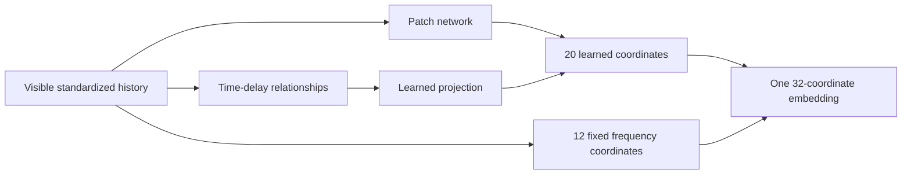

# RPB-v22 encoder: inputs, outputs, architecture and training

Reviewed on 13 October 2026. This is an explanation of implemented code and
saved measurements, not a new experiment. Start here for the tensor contract;
use [current status](CURRENT_STATUS.md) for research direction and the
[v22 module guide](../code/encoders/raw_patch_bottleneck_mae/CONTENT_ORDERED_RELATION.md)
for formulas, settings and checkpoint identities.

RPB-v22.alt-01 is the strongest complete encoder in the matched, completed
TEMPO-5 development comparison. It reads several parallel historical streams
and returns one compact vector describing the whole window. Its 32-coordinate
representation combines 20 learned coordinates with 12 fixed-formula frequency
relationship coordinates. It is a hybrid representation, rather than a wholly
learned embedding.

## Saved results and their scope

No new experiment. The values below reuse the
[completed content-only relation report](CONFIGURABLE_CONTENT_RELATION_V1.md)
and its [saved result](results/configurable_content_relation_v1.json).
These are known TRAIN/VALIDATION development cohorts, not fresh confirmation,
TEST or market measurements. All three cohorts and all declared head fits are
retained; this guide selects no best seed or checkpoint.

RPB-v20.alt-01 is the matched patch-network plus fixed-spectral reference.
RPB-v22.alt-01 adds a learned projection of normalized time-delay relationships.
The raw baseline contains observed values and their observation flags.

Each cohort has 512 TRAIN examples from 256 source groups and 256 VALIDATION
examples from 128 disjoint groups. Three independent v22 encoder trajectories
use CUDA:0, float32, batch 8 and 512 updates at C3/H128/F9/P8/W64/D32. V20 and
raw scores are reused saved controls. Classifiers are fitted separately on TRAIN:
ridge penalty 1, and a 16-tanh-unit neural head with Adam 0.01 for 100 updates.
Three head repetitions use seeds 2701/2802/2903; they are not three encoder runs.
Native32 heads have 66/562 parameters; raw6912 heads have 13,826/110,642, so raw
and compact inputs do not imply equal head capacity. Evaluation follows
[configurable-content-relation-v1](../code/evaluation/cards/configurable_content_relation_v1.md).

**Dataset: TEMPO-5 · timing · designed complexity 5/5:** slow lead/lag beneath
fast rhythms, nine grouped features and structured distractors. Intact
VALIDATION; equal means across the three cohorts and three head repetitions.

| Method | Size | Linear head % | Neural head % | Coverage % |
| --- | ---: | ---: | ---: | ---: |
| RPB-v20.alt-01 | 32 | 94.66 | 94.31 | 100.00 |
| RPB-v22.alt-01 | 32 | 97.14 | 95.96 | 100.00 |
| Raw data — no encoder | 6912 | 49.61 | 50.69 | 100.00 |

Accuracy is the fraction of correct predictions among valid examples. Coverage
is the fraction of the declared evaluation population with a valid prediction;
it is not confidence. Complexity is an ordinal designed challenge level, not a
mathematical difficulty measurement or a rank inferred from accuracy.

The first 20 learned v22 coordinates alone score 63.54%/62.98% under these same
classifier recipes. The fixed relationships remain a substantial source of
the complete representation's strength. Comparing learned20 with complete32
also changes head width/capacity; it does not isolate a causal contribution.
The report retains missing-value results, initialized controls and per-cohort
details. No PCA follows an encoder.

## Input tensor and ranks

Rank here means the number of tensor axes, not matrix rank. Values have shape
`[B,C,H,F]`, rank 4:

| Axis | Meaning | Tested setting |
| --- | --- | ---: |
| B | Samples processed together | 8 during training |
| C | Parallel semantic channels or streams | 3 |
| H | Historical time steps per channel | 128 |
| F | Numerical features at each time step | 9 |
| D | Final embedding width; an output setting | 32 |

Channels and features are separate axes. For example, three channels could be
three instruments, each with nine numerical candle features at every historical
time step. This example does not automatically support different timeframes:
the declared channels must share an aligned, uniform timestamp grid.

One C3/H128/F9 sample contains `3 * 128 * 9 = 3,456` numerical values.
The raw evaluation baseline's 6,912 coordinates include those 3,456 values and
3,456 observation flags. The flags do not double the encoder's F axis.

| Input | Shape | Rank | Meaning |
| --- | --- | ---: | --- |
| Values | `[B,C,H,F]` | 4 | Raw historical measurements before scaling |
| Observation mask | `[B,C,H,F]` | 4 | Boolean availability for each value |
| Semantic channel IDs | `[C]` or `[B,C]` | 1 or 2 | Known channel identities, independent of physical storage order |
| Window endpoints | `[B]` | 1 | Floating timestamps identifying the historical windows |
| Sampling interval | Scalar | 0 | Positive uniform spacing matching the configured schema |

Raw values may be float32 or float64. The scaler produces normalized CUDA
float32 values. Channel IDs are int64. Direct `model.encode(input)` calls require
normalized float32; they do not automatically apply the checkpoint's scaler.
Endpoints are optional for direct model calls but required by workflow archives.

The quality experiments use synthetic TEMPO-5 features, not actual market
klines. In the sibling `cuwacunu` market adapter, F9 has this exact order:
open, high, low, close, volume, quote volume, trade count, taker-buy base volume
and taker-buy quote volume. These are raw loader values before the encoder's
TRAIN-fitted standardization. Timestamps remain separate metadata.

The loader's row mask `[B,C,H]` expands over features. A missing candle marks
all its features absent; a nonfinite individual feature marks only that value
absent. Future values, masks and timestamps from the loader do not enter this
past-only adapter. Market loading remains outside `cuwacunu_embedding`.

## What is added to the values

The frozen scaler fits a population mean and standard deviation separately for
each semantic channel/feature using observed TRAIN values across samples and
history. Statistics have shape `[C,F]`, not `[C,H,F]`. Standard deviations have
a floor of 1e-6. The same fitted scaler is reused for validation and serving.

Observed values become `(value - mean) / scale`; absent values become zero and
retain a false mask. An observed zero and an absent zero therefore remain
distinguishable. There is no interpolation or invented target value.

The learned backbone additionally receives:

- Per-value observation flags concatenated with each patch's values.
- Learned embeddings identifying original patch positions and semantic channels.
- Channel-valid flags when combining the per-channel summaries globally.

The deterministic relation branches derive their measurements from the same
visible, standardized historical values and masks. They add no external data.
V22 removes additive observation-density fractions only from its new relation
projection; masks still inform the backbone and relation validity.

Endpoint timestamps select/validate past windows and record provenance. Absolute
endpoint or calendar time is not fed numerically into the encoder. The interval
is checked against the uniform schema; time-delay comparisons preserve original
tick positions even when observations are absent. Feature meaning follows the
declared feature order; there is no separate feature-ID input tensor.

## Output: one global embedding per window

The final v22 native embedding has shape `[B,D]`, rank 2. At the tested settings:

```text
Values:            [8, 3, 128, 9]
Observation mask:  [8, 3, 128, 9]
Native embedding:  [8, 32]
Sample validity:   [8]
```

Each sample receives one vector combining all channels, features and historical
positions. The native output has no channel or time axis. A sequence can be
made by encoding successive windows and stacking their vectors; it is not a
sequence returned by one window's encoder call.

`EncodeOutput` contains diagnostics as well as the served vector. The table
distinguishes its fields from the separate decoder output:

| Output | Shape | Rank | Use |
| --- | --- | ---: | --- |
| Final `z_contextual_global` | `[B,D]` | 2 | Complete native v22 embedding |
| `sample_valid_mask` | `[B]` | 1 | Whether each sample has any observed support |
| `channel_valid_mask` | `[B,C]` | 2 | Whether each channel has observed support |
| Inherited `z_local`, `z_contextual` | `[B,C,D]` | 3 | Backbone diagnostics, not complete v22 embeddings |
| Separate decoder reconstruction | `[B,C,H,F]` | 4 | Returned by `decode`, or in `ForwardOutput.reconstruction` |

The inherited per-channel summaries and ordinary `z_global` do not include the
final learned/fixed relation composition. Extract the complete output through
`compact_reconstruction_export(output, config)`, or the sibling public API's
`native_embedding(output, config)`. Entirely absent samples return a finite zero
native vector and false validity. Validity records support, not certainty or
guaranteed task information.

## Network architecture

The diagram uses the tested C3/H128/F9/D32 geometry. All three routes read only
visible context during training.



### Patch network

1. Split each channel's history into non-overlapping patches of P8 ticks. H128
   gives 16 possible patches per channel. A patch contains 72 values and 72
   observation flags, so a learned linear layer maps 144 inputs to a W64 token.
2. Add learned patch-position and semantic-channel embeddings. Entirely absent
   patches are omitted; surviving patches retain their original indices.
3. Apply one pre-normalized attention block across available channels at each
   original patch position, before temporal encoding. Missing channels are
   excluded by attention masks.
4. Apply three shared pre-normalized temporal Transformer blocks to each
   channel's contextual tokens. Each has four attention heads, width 64,
   feedforward width 256, GELU and residual connections. Dropout is zero.
5. Apply learned position-aware weighted pooling across the available patches,
   then a linear 64-to-32 projection to obtain each channel summary.
6. Put summaries in canonical semantic channel order. Concatenate three
   32-coordinate summaries and three channel-valid bits: 99 inputs. A
   99-to-64-to-32 GELU network produces the global backbone vector. A trainable
   32-to-20 projection produces the base learned portion of the final embedding.

The implementation also computes the ordinary temporal path for local
diagnostics, sharing the registered temporal weights. It is not another trained
encoder or a CPU replay, and it has no separate reconstruction loss. The final
served representation uses the contextual path described above.

### Learned time-delay relationship route

For every semantic channel pair and all F squared cross-channel feature pairs,
compute normalized relationships at original tick delays 1, 2, 4 and 8.
An odd moment describes directional time ordering; an even moment describes
shared patterns. Each comparison requires four actually observed endpoints:
both streams at the original time and at the delayed time. Shared support
determines centering, normalization and eligibility.

At C3/F9 there are three channel pairs, 81 feature pairs, four delays and two
moments: `3 * 81 * 4 * 2 = 1,944` measurements per sample. A bias-free learned
20-by-1,944 projection adds 20 numbers to the patch network's learned portion.
Its 38,880 weights start at literal zero without consuming initialization RNG;
matching initial seeds/inputs therefore preserve the v20 initial native values.
The measured v22 trajectories train from initialization, not by overwriting or
continuing a saved v20 instance.

Moment calculations accumulate on CUDA in float64, then the bank/projection
uses float32. Insufficient support or energy makes a relationship zero. Masks
can still alter estimates or remove information; removing support fractions is
not invariance to arbitrary missing values. The
[module guide](../code/encoders/raw_patch_bottleneck_mae/CONTENT_ORDERED_RELATION.md)
specifies the exact formulas and guards.

### Fixed frequency relationship route

For every channel pair, measure frequency relationships over the original
history using sine/cosine fits on common observed support. The lower band uses
harmonics 1-3 and the higher band 4-8. Real and imaginary cross-relations describe
similarity and relative phase. Average across all feature pairs and normalize
each pair's four-coordinate group.

Three channel pairs therefore contribute 12 coordinates. The calculation and
averaging weights are fixed, while the resulting numbers change with the input.
They are not separately trained or a post-encoder PCA transform.

The final output concatenates the adjusted 20 learned coordinates with these
12 fixed-formula coordinates. At the tested geometry the full training model,
including its decoder, has 282,521 parameters: 278,633 trainable and 3,888 frozen.

## Reconstruction decoder

The decoder receives the exact final native vector, not the original visible
values or a per-channel bypass. At each channel/patch position it combines the
same D32 global vector with a 16-coordinate learned patch-position embedding
and a 16-coordinate learned channel embedding. A 64-to-128-to-72 GELU network
predicts the patch's P8/F9 standardized values.

Patches reshape into `[B,C,H,F]`. Private padding for nondivisible histories is
cropped back to logical H. Predictions are in standardized units; raw-unit
predictions require applying the scaler's inverse transformation separately.
The decoder is needed for reconstruction training or reconstruction requests,
not ordinary embedding extraction. A classifier is not required for encoding.

## Training recipe and targets

The completed recipe is self-supervised masked waveform reconstruction. Class
labels, classifiers, JEPA/EMA, VICReg and contrastive losses do not enter this
encoder's optimizer.

The 15% context-erasure augmentation and 512-update budget belong to the
experiment runner. They are not automatically applied by `model.encode` or the
core `model.forward` API.

1. Fit the frozen scaler using TRAIN only, then normalize the permitted windows.
2. Sample a batch of eight TRAIN rows. Hide approximately 25% of the observed
   patches in each eligible channel, rounded/clamped to retain at least two
   visible patches and one observed target patch. Naturally absent values are
   never reconstruction targets.
3. Erase each remaining visible coordinate with probability 15%, with support
   repair where necessary. This changes visible context only. These extra
   erased values are not added to the original hidden-patch target set.
4. Encode only the retained visible context. Reconstruct from its final global
   embedding and the decoder's channel/position metadata.
5. Score Huber loss only on originally observed values in hidden target patches.
   Average target-cell losses within each eligible channel, then eligible
   channels within each sample, then eligible samples. Jointly update the
   trainable backbone, projections and decoder; fixed spectral weights stay frozen.

| Setting | Completed recipe |
| --- | --- |
| Encoder device/parameter dtype | CUDA:0 / float32 |
| Batch size | 8 |
| Completed optimizer updates | 512 |
| Optimizer | AdamW |
| Learning rate | 0.001 |
| Weight decay | 0.0001 |
| Gradient norm clipping | 1 |
| Huber delta | 1 |
| Original patch masking | Approximately 25% of observed patches |
| Additional visible-coordinate erasure | Probability 15%, with support repair |

With 512 TRAIN examples, 512 batches of eight correspond to eight dataset-sized
row presentations, sampled with replacement. They are not eight strict shuffled
epochs. All encoder/decoder training and feature extraction run on CUDA.
Scaler/metadata preparation, fixed classifier fitting and saved-array arithmetic
may use CPU; they do not repeat encoder training or inference on CPU.

**Dataset: TEMPO-5 · timing · designed complexity 5/5:** slow lead/lag beneath
fast rhythms, nine grouped features and structured distractors. Original
hidden-patch reconstruction queries on TRAIN/intact VALIDATION; equal means
across the same three cohorts, 512 updates/B8/CUDA, with fixed TRAIN scales.

| Encoder | Updates | Train error ↓ | Validation error ↓ | GPU training seconds |
| --- | ---: | ---: | ---: | ---: |
| RPB-v20.alt-01 | 512 | 0.78245 | 0.79860 | 20.8 |
| RPB-v22.alt-01 | 512 | 0.78334 | 0.80402 | 24.7 |

These errors are hierarchical standardized MAE, not the optimized Huber loss.
Queries leave one original complete patch out at a time; their coverage is
100%. GPU seconds are synchronized training-loop means per trajectory, excluding
feature extraction, reconstruction queries, transfers/output outside that loop,
CPU heads and archive audits. The v22 reconstruction error is slightly higher
than v20 while remaining within the declared protection margins; classification
and reconstruction measure different behavior.

## Evaluation is separate from embedding training

After training, freeze the encoder and capture its native vectors. Fit the fixed
linear and neural classifiers and their normalizers separately using TRAIN
vectors and labels. Score them on the declared validation views. Head repetitions
are separate classifier fits, not encoder retraining. No head tuning or PCA after
the encoder is used to obtain the saved comparison.

The reusable model owns encoding, masks, scaling and reconstruction. Shared
evaluation owns synthetic datasets, role/source splits, classifiers, metrics
and comparison rules. See the [evaluation policy](EMBEDDING_EVALUATION_POLICY.md)
and [reporting standard](RESULTS_REPORTING_STANDARD.md).

## Configurable dimensions and repository boundary

C, H, F, D, semantic IDs, sampling interval and network widths are settings
bound to a constructed model/checkpoint. Batch size may vary. A configuration
change is not permission to reshape an existing trained checkpoint silently;
construct/train the matching geometry and preserve its own artifact identity.

V22 inherits the v20 constraints:

- H must be at least 17 to support the eight non-Nyquist harmonics.
- H need not divide by patch length; only the learned backbone pads privately,
  while relation arithmetic uses original H and reconstruction returns original H.
- With `Q = C * (C - 1) / 2` channel pairs, the fixed width is `4*Q` and the
  learned width is `D - 4*Q`, which must be positive. C1 has no cross-channel bank.
- All F features enter the backbone and all F squared feature pairs enter the
  relation banks. Larger C/F can materially increase relationship computation.
- CUDA float32 model execution and the configured uniform sampling schema are
  required. Correctness checks at other shapes do not measure their quality,
  maximum input size or throughput.

Use [the v22 settings](../code/encoders/raw_patch_bottleneck_mae/config/content_ordered_relation.conf)
and [typed API guide](../code/encoders/raw_patch_bottleneck_mae/CONTENT_ORDERED_RELATION.md).
The inference checkpoint binds the scaler, geometry, semantic IDs, architecture
layout and completed update count; it is not an optimizer/RNG resume checkpoint.

`cuwacunu_embedding` owns reusable encoders and evaluation research. The sibling
`cuwacunu` owns market loading and its past-only adapter. The optional v22 API
has been synced and passed a focused artificial CUDA integration check there;
its selected v20 settings remain unchanged, and no synthetic trained checkpoint
has been chosen for markets. See the sibling
[sync manifest](../../cuwacunu/doc/CONTENT_ENCODER_SYNC.json).

The next quality direction is an unchanged-v22 fresh synthetic confirmation,
specified prospectively before allocating data. It has not been implemented
or measured. Follow the
[continuation](CONTINUATION_2026-10-13_AFTER_CONTENT_RELATION.md); longer-history,
missing-block and market challenges remain separate work.
